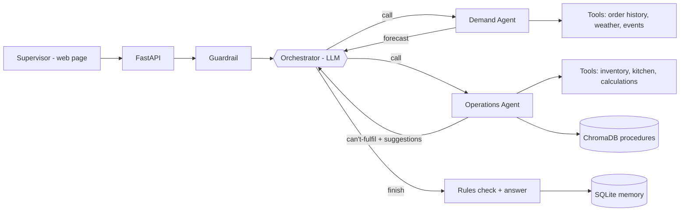

<<<<<<< HEAD
# Cloud Kitchen Autopilot: a multi-agent AI system

AI agents that tell a cloud-kitchen supervisor **which orders the kitchen can't fulfil in the next few
hours, why, and what to do about it**. The system only gives suggestions; the supervisor decides.

Example answer:

> Expected about 229 orders in the next 2h (+80% vs normal). With current stock we can't fulfil about 23
> expected orders: 10 Chicken Biryani and 7 Butter Chicken (Chicken runs out around 20:44; reorder now, a
> delivery can arrive about 20:00); 6 Margherita Pizza (Mozzarella runs out around 20:46; the next delivery
> only arrives about 23:00) …
>
> Suggestions: reorder 8 kg chicken now · stop taking Margherita Pizza orders after about 38 more ·
> move one cook to the biryani station …

## How to explain this project (2 minutes)

1. **The problem.** Demand changes quickly (rain, a cricket match, a festival). Kitchens run out of
   ingredients and get overloaded, and people notice too late.
2. **The agents.** An **Orchestrator** (the manager) receives the question and decides who to ask. The
   **Demand Agent** forecasts orders. The **Operations Agent** checks stock and kitchen capacity, works out
   which orders can't be fulfilled, looks up company procedures and writes suggestions.
3. **How they think.** Each agent uses an **LLM (OpenAI)** to reason and explain. The numbers come from
   **tools** (order history, weather, inventory, calculations), so the AI doesn't make them up.
4. **Safety.** The system only **suggests**. Rules check every suggestion (budget, quantities, suppliers),
   and the supervisor decides what to do.
5. **The tech stack:**

| Topic | Where it is in this project |
|---|---|
| **Multi-agent** | Orchestrator + Demand Agent + Operations Agent, connected with **LangGraph** |
| **Prompt engineering / dynamic prompts** | Fixed system prompts plus live context added at run time (time, accuracy, retrieved procedures) |
| **RAG + ChromaDB** | Kitchen procedure documents in ChromaDB; the Operations Agent retrieves and cites them |
| **LangChain / LangSmith** | LangChain connects to OpenAI; LangSmith shows a trace of every step |
| **FastAPI** | The web server: REST API, the web page and automatic API docs at `/docs` |
| **MCP** | An MCP server exposes the kitchen tools to other AI apps such as Claude Desktop |
| **GitHub** | GitHub Actions runs all tests on every push |
| **Render** | One-click deployment with `render.yaml` |

New to the code? Read [`docs/CODE_GUIDE.md`](docs/CODE_GUIDE.md).

---

## 1. Setup and run

Requires Python 3.10+.

```bash
cd cloud-kitchen-autopilot
python -m venv .venv
source .venv/bin/activate          # Windows: .venv\Scripts\activate
pip install -r requirements.txt
cp .env.example .env               # Windows: copy .env.example .env
```

Open `.env` and add your key:

```properties
OPENAI_API_KEY=sk-...your key...
LLM_MODEL=gpt-4o-mini
# Course keys starting with "voc-" also need:
# OPENAI_BASE_URL=https://openai.vocareum.com/v1
```

Run the tests, then start the app (the first start downloads ChromaDB's small embedding model, about 80 MB):

```bash
python -m unittest discover -s tests -t . -v
python run.py --reset
```

Open **http://127.0.0.1:8000**. The badge at the top right shows the AI model in use. API docs are at
http://127.0.0.1:8000/docs.

**Using the app:** type a question and click **Get suggestions**. You'll see the answer, the **orders we can't
fulfil** table and the **suggestions**. Open **How the agents worked this out** to see each agent's reasoning.

Without a key, the same workflow runs with rule-based agents.

### Live data and simulated incidents

**Normally the app uses live data:** real weather from **Open-Meteo** (free, no key) and real holidays and
festivals from **Calendarific** (free key). Orders and stock are demo data. Set in `.env`:

```properties
WEATHER_SOURCE=open_meteo
KITCHEN_LATITUDE=12.9716             # your kitchen's location
KITCHEN_LONGITUDE=77.5946
HOLIDAY_SOURCE=calendarific
CALENDARIFIC_API_KEY=your-key        # without a key, holidays fall back to demo data
HOLIDAY_COUNTRY=IN
```

**Simulate an incident on demand** with the toggles on the page (or `POST /api/simulation`):

| Toggle | What it does |
|---|---|
| Heavy rain | Overrides the live weather with rain |
| Festival | Overrides the live holiday check with a festival |
| Cricket match | A major match tonight (always simulated; there's no free match API) |
| Order rush | Orders running hot right now (65 in the last hour instead of 38) |
| Weather API down / Holiday API down / Inventory API down | The tool fails as if the service were down; the real API isn't called |
| Busy evening | Heavy rain + cricket match + order rush in one click |
| Back to live data | Switches every incident off |

Each incident overrides only its own piece of data, so you can mix live data with a staged incident. The
answer shows where each value came from, e.g. **Data used: Weather: rain (simulated incident) · Holiday/
festival: none (Calendarific, live)**. Weather is re-fetched every 10 minutes and holidays once per day. If a
live service fails for real, the forecast continues without it at lower confidence. The kitchen runs on
the system clock (your computer's date and time); weather is fetched for now and holidays for that date.
To try another day or time, use **Simulate a date** and **Simulate a time** on the page (e.g. 8 Nov 2026
is Diwali, so live Calendarific data then shows a real festival; 19:00 is the busiest hour). **Back to live
data (today)** returns to the system clock and switches every incident off. The page shows the date and time
in use and whether it is live or simulated. The kitchen is open 10:00-23:00; outside those hours the answer
says the kitchen is closed and asks you to simulate a time. Only main festivals and national holidays
(Calendarific `type=national`, e.g. Diwali, Holi, Eid, Christmas) count; small observances are ignored.

---

## 2. How it works



1. The supervisor asks a question. FastAPI validates it and a guardrail blocks unsafe or off-topic text.
2. The **Orchestrator** (LLM) decides the next step: usually the Demand Agent first.
3. The **Demand Agent** forecasts orders with statistics, then the LLM reviews and explains the forecast.
4. The Orchestrator decides again: if there's a spike or a stock question, it calls the Operations Agent.
5. The **Operations Agent** calculates which orders can't be fulfilled, when each ingredient runs out and
   whether a delivery can arrive in time, retrieves matching procedures (RAG) and chooses suggestions.
6. The Orchestrator writes the answer. Code checks every suggestion against the rules and saves the result.

**What the LLM decides and what code decides**

| Step | LLM decides | Code enforces |
|---|---|---|
| Orchestrator | Which agent to call next, when to finish or ask for clarification, the answer | Valid decision format (Pydantic), forecast before operations, a 6-step limit |
| Demand Agent | Adjustment to the forecast, confidence, explanation | Adjustment limited to 0.8x–1.25x; spike recalculated |
| Operations Agent | Which suggestions to give and why, citing procedures | All numbers (can't-fulfil, run-out times, quantities); critical suggestions can't be dropped |
| Rules | Nothing | Budget, max quantity and approved supplier checked on every suggestion |

### How "orders we can't fulfil" is calculated

For each dish, the scarcest ingredient decides how much of the expected demand can be covered:

```
need (kg)    = forecast use + normal loss          (for the time window)
coverage     = stock / need                       (shared fairly between dishes that use it)
can serve    = expected orders x coverage
can't serve  = expected orders - can serve
runs out at  = when cumulative hourly use reaches the stock
next delivery = now + supplier lead time  ->  "in time" or "too late"
```

If the delivery arrives in time, the suggestion is **reorder now**. If it's too late, the suggestion is
**stop taking that dish after N more orders**.

---

## 3. RAG, dynamic prompts and MCP

**RAG with ChromaDB.** `knowledge/` holds six short procedure documents (shortages, suppliers, food
safety, peak hours, menu pauses, procurement policy). At start-up they're split into sections, embedded
and stored in ChromaDB. The Operations Agent searches with the risks it found, gets the best-matching
sections (for example `SOP-04#2 Station overload`), and the LLM cites them. Below a similarity of 0.25
nothing is returned, and the prompt says not to invent procedures.

**Dynamic prompts** (`app/llm/prompts.py`). Each prompt has a fixed part (role, rules, output format) and
a part built at run time:

| Agent | Added at run time |
|---|---|
| Orchestrator | The current time and closing hour |
| Demand Agent | Its own recent accuracy, e.g. "you under-forecast by 8%" |
| Operations Agent | The procedures found by RAG, or "no procedure found, don't invent one" |

**MCP server** (`app/mcp_server.py`, official MCP SDK v2): four tools, `forecast_demand`,
`check_kitchen_status`, `search_procedures` and `plan_for_demand`. Run it with `python -m app.mcp_server`.

---

## 4. GitHub and Render

**GitHub.** `.github/workflows/ci.yml` runs all tests on every push (no API key needed). `.env` is in
`.gitignore`, so keys are never committed.

**Render.** In the Render dashboard choose **New → Blueprint** and select the repository. Enter
`OPENAI_API_KEY`, `BASIC_AUTH_USER` and `BASIC_AUTH_PASSWORD` when asked; the password protects the public
site. On the free plan, data resets on each restart and the app re-creates it.

---

## 5. Project structure

```
cloud-kitchen-autopilot/
├── run.py                       # start-up: database, knowledge base, FastAPI server
├── requirements.txt
├── .env.example                 # settings (only OPENAI_API_KEY is required)
├── render.yaml                  # Render deployment
├── .github/workflows/ci.yml     # GitHub Actions
├── knowledge/                   # 6 kitchen procedure documents (RAG source)
├── app/
│   ├── api/main.py              # FastAPI: endpoints, validation, request IDs
│   ├── graph/                   # LangGraph: workflow.py (map), nodes.py (steps), finalize.py (rules + answer)
│   ├── agents/                  # demand_agent.py, operations_agent.py, guardrails.py, base.py (PRAL)
│   ├── llm/                     # client.py (ChatOpenAI), prompts.py, schemas.py
│   ├── rag/knowledge_base.py    # ChromaDB: chunk, embed, search
│   ├── tools/                   # data, calculations, policy engine, memory
│   └── mcp_server.py            # MCP server
├── static/                      # web page (index.html, app.js, styles.css)
├── tests/                       # 54 tests
└── docs/                        # CODE_GUIDE.md, WORKBOOK.md
```

## 6. API (FastAPI, docs at `/docs`)

| Method | Path | Purpose |
|---|---|---|
| GET | `/health` | App, database and AI status |
| POST | `/api/plan` | `{"request": "...", "horizon_hours": 2}`: answer, orders we can't fulfil, suggestions |
| GET | `/api/decisions`, `/api/decisions/{id}` | Past answers |
| POST | `/api/decisions/{id}/outcome` | `{"actual_orders": 230}`: real orders, so the forecast learns |
| GET/POST | `/api/simulation` | Read or switch simulated incidents, e.g. `{"incidents": {"rain": true}}` |
| GET | `/api/metrics`, `/api/audit` | Metrics and audit log |
| POST | `/api/reset` | Reset demo data |

## 7. Tests

```bash
python -m unittest discover -s tests -t . -v
```

54 tests, none of which calls a real model or a real API (the LLM tests use a scripted fake model). They cover: a normal
evening, a surge, the can't-fulfil numbers, reorder-vs-limit timing, suggestions changing nothing,
vague, off-topic and unsafe questions, data outages, rule checks, learning, LLM routing and limits, RAG,
dynamic prompts, MCP, live weather and holidays (mocked), simulated incidents and the FastAPI endpoints.

## 8. Troubleshooting

| Symptom | Fix |
|---|---|
| `Missing packages` on start | Activate the environment, then `pip install -r requirements.txt` |
| Badge says **AI off** | Check `OPENAI_API_KEY` in `.env`, then restart |
| "AI failed" with error 401 | Wrong key; a `voc-` key also needs `OPENAI_BASE_URL` |
| Model not found | Set `LLM_MODEL` to a model your account allows |
| Port 8000 in use | Add `APP_PORT=8001` to `.env` |
| "Knowledge base not available" | The first start needs internet for the embedding model |
=======
# cloud-kitchen-autopilot
Agentic AI based cloud kitchen automation
>>>>>>> 0c110572ee2163f4573ec9cc22ffb8499b6f6105
